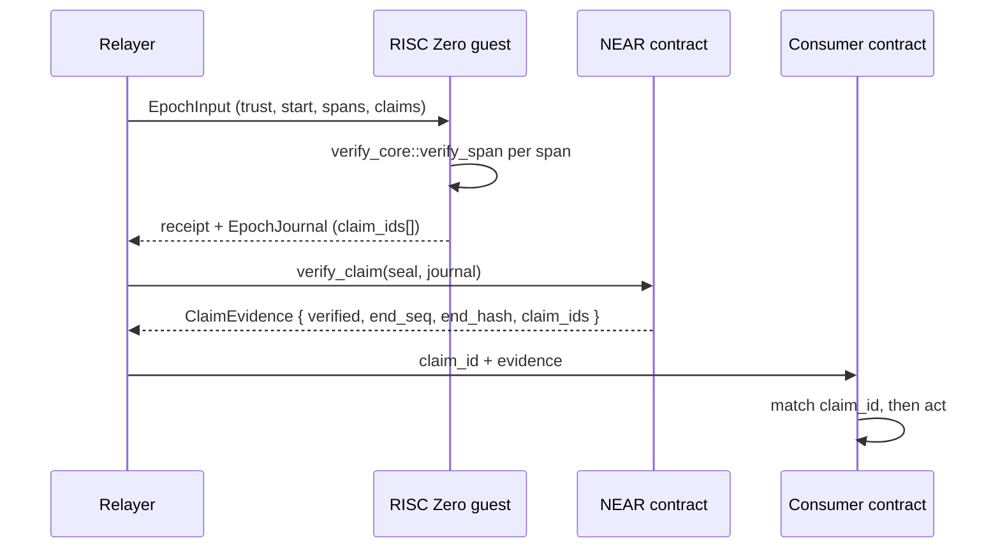

# 01 - Transaction inclusion attestation

**Status: shipped.** Everything described here exists in this repository.

## Problem

A consumer on another chain needs to know that a specific Stellar transaction was
actually included in a ledger the Stellar validator quorum signed — without
trusting a relayer's word for it.

## What the light client proves

A claim is `(tx envelope XDR, tx_index)`. Verification
(`verify-core/src/lib.rs:345-360`) checks:

1. the tail transaction set is present (`ClaimsRequireTxSet`) — inclusion cannot be
   proven without it;
2. an authenticated predecessor header is present (`ClaimsRequirePredecessor`);
3. `tx_index` is in range of the parsed transaction set;
4. the re-encoded envelope at that index is byte-identical to the claim
   (`ClaimEnvelopeMismatch` otherwise);
5. `claim_id = sha256(tx envelope)` is emitted.

Claim ids accumulate across every span in an epoch and are committed to the
journal (`guest/methods/guest/src/lib.rs:64-66`), so a consumer holding a verified
receipt can ask "was my transaction in this epoch?" by hash.

The tail transaction set is what makes this meaningful: its signed
`txSetHash` commits to exactly its contents, and its `previousLedgerHash` pins the
chain backwards (`verify-core/src/lib.rs:312-340`). Both generalized and legacy
stellar-core encodings are handled, hashed the way `TxSetFrame.cpp` does — over the
whole XDR for generalized, `SHA256(prev || envelopes)` without the vector count for
legacy.

## Flow



Direct path without ZK, when gas is not a concern: call `submit_span` with
`tx_claims` filled in and read the returned `SpanEvidence`
(`contract/src/lib.rs:264-291`). `submit_span_raw` takes Borsh and is roughly 27%
smaller in calldata — it skips base64 (1.33x) and JSON parsing
(`contract/src/lib.rs:97-98`).

## Proving outcomes — shipped

"Inclusion is not execution" described what this repository verified before
outcome support landed. Outcomes are now implemented, and they are provable from
the same evidence chain: `LedgerHeader.tx_set_result_hash` commits the
`TransactionResultSet`, and the span already authenticates that header.

`LedgerHeader.tx_set_result_hash` is documented as *"the TransactionResultSet that
led to this ledger"* (`stellar-xdr` 28.0.1, `generated/ledger_header.rs`), and
stellar-core sets it as:

```cpp
ltx.loadHeader().current().txSetResultHash = xdrSha256(txResultSet);
```
(`src/ledger/LedgerManagerImpl.cpp:1883`)

A `TransactionResultSet` whose XDR hashes to the header's `tx_set_result_hash` is
therefore as authentic as the transaction set already verified here. The XDR comment
on `TransactionResultSet` is explicit about the purpose: *"used to recover results
between ledgers."*

What that buys:

| proved from `tx_set_result_hash` | where |
|---|---|
| success or failure of the transaction | `TransactionResultResult::TxSuccess` / `TxFailed` |
| per-operation result codes | `VecM<OperationResult>` |
| fee charged | `TransactionResult.fee_charged` |
| Soroban return value **and emitted contract events** | `InvokeHostFunctionResult::Success(Hash)` = `sha256(InvokeHostFunctionSuccessPreImage { return_value, events })` |
| why a submission was rejected | `TxBadSeq`, `TxInsufficientBalance`, `TxTooEarly`, `TxInsufficientFee`, ... |

The Soroban row is the answer to "can we prove receipt events": the events sit
*inside* the hashed success preimage
(`generated/invoke_host_function_success_pre_image.rs`), so they are committed by the
header through the result set. Supply the preimage, hash it, compare against the
`Success(Hash)` in the proven result, and the events are exactly the ones the ledger
agreed on.

### The join-key trap

`TransactionResultPair.transactionHash` is **not** the envelope hash that `claim_id`
uses. stellar-core sets it to `tx.getContentsHash()`
(`LedgerManagerImpl.cpp:2839`), which is the network-bound signature payload hash:

```cpp
mContentsHash = sha256(xdr_to_opaque(mNetworkID, ENVELOPE_TYPE_TX, mEnvelope.v1().tx));
```
(`src/transactions/TransactionFrame.cpp:172-173`; the v0 case adds a `0` tag)

whereas `claim_id = sha256(xdr(TransactionEnvelope))`
(`verify-core/src/lib.rs:359`) — `getFullHash()`, which includes signatures. They
are different hashes of the same envelope. Joining a result to a claim requires
recomputing the contents hash from the claimed envelope, and the network id needed to
do it is already carried as `Trust.network_id`
(`verify-core/src/lib.rs:55-56`). Matching positionally on `tx_index` works but is
weaker.

Note the public "transaction hash" (Horizon, Stellar RPC) is `getFullHash()`. So the
result set's join key is not the identifier users or explorers quote. Do not assume
they are interchangeable.

### What is still not provable

`TransactionMeta` — `tx_changes_before` / `operations` / `tx_changes_after` balance
and trustline deltas, plus diagnostic events — is **not** header-committed.
`LedgerHeaderExtensionV1` is only `{ flags, ext: V0 }`
(`generated/ledger_header_extension_v1.rs`), and `TransactionResultMeta` — which is
where meta lives, `{ result, fee_processing, tx_apply_processing: TransactionMeta }`
— is published in `LedgerCloseMeta`, an observer-facing structure that no header
hashes.

So a classic `Payment` proves its result code and the fee charged, not the balance
deltas it moved. See use case 04: a Stellar balance still cannot be derived from
committed data without replaying state.

## What it does NOT prove

**Inclusion alone is not execution.** A bare `claim_id` says only that the envelope
sat at index N of an authenticated transaction set. Outcomes are a separate claim
kind — `outcome_claims`, proven against an authenticated `TransactionResultSet` —
and a consumer that wants to know a transaction *succeeded* must carry one.

**Effects are still out of reach.** `TransactionMeta` balance and trustline deltas
are not header-committed, so a proven `Payment` result code and fee still do not
yield the balance it moved. See use case 04.

It also does not prove *finality in the Stellar sense* beyond the span discipline:
the stored head is `authenticated_head` — the predecessor pinned by the signed tail
transaction set. The tail header itself is provisional and is pinned only by a later
span that brings a set (`contract/src/lib.rs:264-271`). A claim against a tail set
is therefore proven through the ledger *before* the tail.

## Trust model

- Trust set is operator configuration, not consensus: node ids and a threshold are
  pinned (`verify-core/src/lib.rs:51-73`). Stellar has no on-chain validator set.
- `trust_digest` is domain-separated (`stellar-lightclient/trust/v1\0`) and
  order-independent over sorted node ids (`verify-core/src/lib.rs:75-90`).
- The journal commits `policy_digest`, so the guest is bound to the policy that
  produced the epoch (`verify-core/src/journal.rs:18-21`).
- Fixtures are not a trust anchor. `xtask fetch-fixture` authenticates signatures
  and internal consistency, but fixture-supplied signer IDs are not an independent
  mainnet anchor — pin validator identity separately.

## Acceptance criteria

- [x] Claim ids are `sha256` of the exact envelope bytes proven.
- [x] Claims fail closed without a tail transaction set or without an authenticated
      predecessor.
- [x] A tampered envelope at a claimed index is rejected
      (`ClaimEnvelopeMismatch`).
- [x] Journal round-trips exactly and rejects v0 and trailing-garbage encodings
      (`verify-core/src/journal.rs:22-24`).
- [x] Result set accepted only when `sha256(TransactionResultSet)` equals the
      authenticated head header's `tx_set_result_hash`.
- [x] Results joined to claims by recomputing the contents hash
      (`network_id || envelope-type || tx`) from the claimed envelope — never by
      assuming `transaction_hash == claim_id`.
- [x] A result row must be an element of the committed set, so `TxFailed` cannot be
      re-presented as `TxSuccess`.
- [x] Outcomes bound to the authenticated head; a fabricated tail header committing
      a fabricated result set is refused.
- [x] Soroban events proven by `sha256(InvokeHostFunctionSuccessPreImage)` equalling
      the `Success(Hash)` carried in the proven result.
- [ ] Consumer contract that matches on `claim_id` and refuses to act on
      `verified: false` or on a zeroed `end_hash` (not in this repo).
