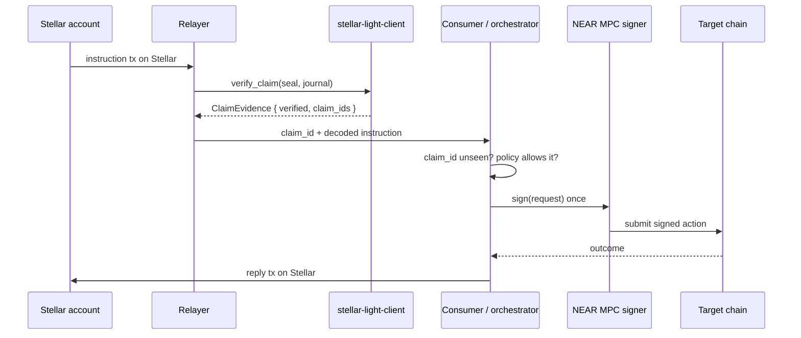

# 02 - Cross-chain request/reply via NEAR MPC

**Status: composes.** The light client supplies authenticity; the signing policy and
the consumer contract are the build.

## Problem

A NEAR-side signer set (an MPC network, a threshold wallet, a universal account)
should act *because something happened on Stellar* — and the Stellar side should be
able to ask back "did that actually work?". Request and reply in both directions,
with no trusted relayer asserting what Stellar did.

The discussion framing was explicit: the MPC network signs **in reaction to**
arbitrary Stellar transactions, not only bridge transfers, and no universal account
needs to exist on Stellar at all.

## What the light client gives you

- **Authenticity of a Stellar event.** Use case 01: a `claim_id` bound to an
  authenticated transaction set. `verify_claim` returns it under this contract's
  epoch policy (`contract/src/lib.rs:568-628`).
- **A settlement boundary that is deliberately yours.** The light client stores only
  the chain head. Its own docs say it: *"Recording a proven transaction as settled is
  the consuming application's business (a bridge built on this light client), not the
  light client's"* (`contract/src/lib.rs:22-28`). `verify_claim` is a view and does
  not advance stored state.
- **Replay handling is the consumer's job too.** `claim_id` is `sha256(tx envelope)`,
  which is unique per envelope, so it is a natural idempotency key. The consumer
  records consumed ids; the light client does not.

## Flow

The reply leg is symmetric: a Stellar-side consumer verifies a NEAR-side fact using
use case 07 (a guest program attesting the NEAR computation) or use case 08 (the
Groth16 verifier ported to Stellar).

## What has to be built

1. **Consumer contract** that (a) calls `verify_claim` or consumes its evidence,
   (b) decodes the instruction from the proven envelope, (c) enforces a spend /
   action policy, (d) dedupes on `claim_id`, (e) hands a deterministic message to
   the signer. Not in this repo.
2. **Signing policy** binding the MPC signer to *specific* claim semantics — which
   asset, which amount, which destination, which instruction opcode. Without this
   the signer is a general-purpose oracle and the whole thing is a bridge with extra
   steps.
3. **Confirmation depth policy.** Decide how many ledgers past `authenticated_head`
   before acting. The span discipline gives you authenticated checkpoints, not
   instant finality (see use case 01).
4. **Failure semantics.** What happens when the target chain action fails after the
   MPC signature is issued. The light client cannot help here.

## Trust model

- The consumer trusts: the pinned validator trust set, the pinned RISC Zero wrapper
  (`control_root`, `bn254_control_id`), the configured `epoch_image_id`, and its own
  policy.
- The consumer does **not** need to trust the relayer. A relayer that submits
  garbage gets `verified: false` and exposes nothing — `verify_claim` returns zeroed
  epoch fields on any failure so invalid evidence leaks no partial state
  (`contract/src/lib.rs:577-622`).
- Owner-only `update_epoch_image_id`, `update_trust`, `update_max_protocol_version`,
  `update_wrapper` are the rotation points. They are upgrade authority; treat them
  as such.

## Limits

- **A proven envelope is a proven submission, not a proven outcome** (use case 01).
- If the instruction depends on the Stellar transaction having *succeeded*, carry
  an outcome claim (use case 01): outcomes are header-committed via
  `tx_set_result_hash` and now implemented. Note they bind to the authenticated
  head, so a claim made in one span has its outcome provable in the next.
- `verify_receipt` is not a shortcut here. It is not epoch-bound and proves nothing
  about Stellar; only `verify_claim` binds to policy and checkpoint.
- Do not store evidence from a provisional span: submissions without a tail
  transaction-set pin are rejected by policy
  (`contract/src/lib.rs:293-303`).

## Acceptance criteria

- [ ] Consumer contract refuses to sign twice for the same `claim_id`.
- [ ] Consumer refuses on `verified: false` and on zeroed `end_hash`.
- [ ] Signing policy rejects an envelope whose decoded instruction is outside the
      allowlist, even when the proof verifies.
- [ ] End-to-end: Stellar instruction tx -> verified claim -> signed target action ->
      reply visible on Stellar.
