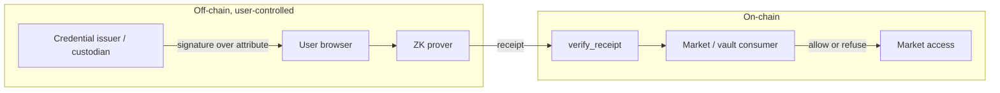

# 03 - Private compliance and access proofs

**Status: new proving work.** The on-chain verifier exists and is reusable; the
credential circuit and the in-browser prover do not.

## Problem

A permissioned market or vault needs to know a depositor is allowed in — KYC'd,
not sanctioned, holding a required accreditation, issued by an approved custodian —
**without** the operator, the intermediary, or the public ledger learning who they
are.

The current shape of this problem is custodial by accident: a broker such as an
identity provider sees the passport, the vault sees the account, the ledger sees the
address. Three parties learn more than the assertion actually requires.

The assertion needed is small: *this caller is permitted, and that fact was vouched
for by an issuer we accept.* Nothing else.

## What the light client gives you

The generic receipt verifier, `verify_receipt`
(`contract/src/lib.rs:508-566`), verifies a RISC Zero Groth16 receipt for a
**caller-named image and journal**. Two properties make it the right hook here:

1. **No new verifier per use case.** The Groth16 key is RISC Zero's wrapper key —
   one key for every program built with the same tooling version. The wrapper is
   pinned once as `control_root` + `bn254_control_id` and is checkable before
   spending gas (`contract/src/lib.rs:468-506`). A credential circuit is a new
   guest program and a new `image_id`, not new on-chain cryptography.
2. **The claim digest is derived on-chain, never supplied.** Only the canonical
   success claim (`Halted(0)`) of that image over that journal can verify; a caller
   cannot redirect the proof to a digest of their choosing
   (`contract/src/lib.rs:547-552`).

`verify_claim` is the wrong entry point for this: it binds to the *epoch* guest
image, the epoch policy, and the chain checkpoint. Credential proofs are not
epochs. Use `verify_receipt` and check `image_id` in the consumer — the contract's
own docs say consumers must do exactly that.

## Proposed shape

The design that keeps the intermediary blind, following the discussion:

1. The issuer signs an attribute statement (accreditation, whitelist membership,
   non-sanctioned) over an identifier the user controls, or over a blinded handle.
2. The user proves **in their own browser** — no shared prover service, so no
   prover learns who is asking — that they hold a valid issuer signature over an
   attribute satisfying the policy, and that the attribute is *not* on a
   denylist.
3. The proof is wrapped so the issuer's signature is verified inside the circuit.
   The verifier sees only: "someone with a valid credential satisfying policy P
   requested access." Not which credential, not which person.
4. The consumer contract checks `image_id` against a pinned credential-circuit
   image, then admits.

"Prove once, move around" falls out of the same structure: the credential proof can
be re-presented per market, and the same wrapper verifies all of them.

## What has to be built

| work item | notes |
|---|---|
| Credential circuit (new guest program) | verifies issuer signature + attribute predicate + non-membership in a denylist |
| Issuer witness format | what exactly gets signed; blinded handle vs. stable identifier is the key privacy decision |
| In-browser prover | proving must work client-side; a shared prover reintroduces the party you were removing |
| Consumer-side `image_id` pinning | the contract deliberately does not do this for `verify_receipt` |
| Denylist update path | and a way to prove non-membership without downloading the list |
| Revocation story | a credential that is valid forever is not compliance |

The Star side (porting the verifier to Stellar, use case 08) is what makes this a
Stellar ecosystem story rather than a NEAR-only one.

## Trust model

- The issuer is trusted to have done real KYC/AML. The proof attests to *their
  assertion*, not to the underlying identity facts. This is the same trust an
  allowlist already carries; the difference is that the assertion stops leaking
  identity downstream.
- The consumer must pin the credential-circuit `image_id`. If it does not, it is
  accepting "some program ran", which is meaningless.
- The wrapper identity is the shared trust anchor. Re-pin the VK and claim digest if
  any *verification* crate bumps — see the `AGENTS.md` version caveat.

## Limits

- **This is not confidential transactions.** It proves an access predicate. Amount
  confidentiality and note privacy are a separate construction.
- **This is not identity.** It proves an issuer's attestation. The discussion itself
  noted identity documents are forgeable; the proof does not change that.
- `AGENTS.md` is blunt about the generic entry point: `verify_receipt` "is not
  epoch-bound and proves nothing about Stellar." Do not let a credential proof be
  read as a chain fact.
- The standard being discussed for permissioned finance on Stellar was referred to
  as "3613" in the 2026-10-09 call. Confirm the exact CAP number before citing it
  in any external grant or partner document.

## Acceptance criteria

- [ ] A valid credential yields `verified: true` and access, with no identifier
      visible to the consumer contract or in the receipt journal.
- [ ] A revoked or denylisted credential yields `verified: false` or is refused by
      the consumer, and the refusal reveals nothing about which check failed.
- [ ] The consumer rejects a receipt from any `image_id` other than the pinned
      credential circuit.
- [ ] Proving completes client-side in a browser without a third-party prover.
