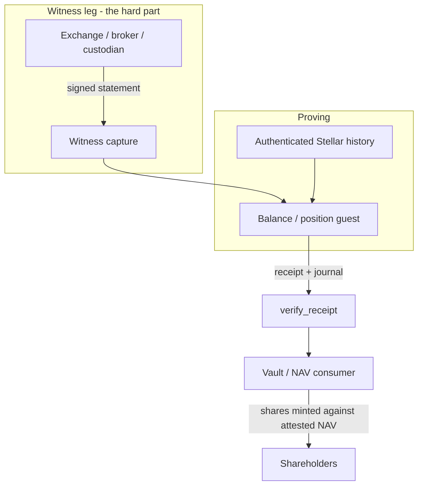

# 04 - Proof of reserves, proof of custody, and off-chain NAV

**Status: new proving work.** The verifier and the epoch machinery are reusable; the
balance/position guest and the witness leg are not built.

## Problem

An on-chain vault issues shares against a portfolio it says it holds. The portfolio
is partly or wholly off-chain: an exchange balance, a brokerage account, a
custodian's address, a fixed-income position. Depositors currently take that on
faith, backed by an audit that is stale the day it is signed.

Three separate assertions get conflated here, and they need different proofs:

| assertion | example | hardest part |
|---|---|---|
| **Proof of reserve** | address `G...` held balance B at ledger L | deriving B from authenticated history |
| **Proof of custody** | a named custodian holds the asset for the vault | the custodian attests; you verify their signature |
| **Proof of NAV** | an off-chain portfolio is worth V at time T | witnessing what the account looks like at all |

The third is the one the discussion called out as the unlock: *if you can prove that
a balance on an exchange is what you say it is, you can do a lot.* It is also the one
with the weakest cryptographic ground, and the spec should not blur that.

## What the light client gives you

- **Authenticated Stellar history.** Spans and inclusion claims (use case 01). This
  is what makes a *Stellar* reserve provable at all.
- **A reusable receipt verifier.** `verify_receipt` accepts any RISC Zero program's
  receipt (`contract/src/lib.rs:508-566`), so a balance-computing guest needs no new
  on-chain verifier, only a pinned `image_id`.
- **A compact commitment format.** `EpochJournal` carries `claim_ids` and the
  policy digest (`verify-core/src/journal.rs:3-24`); a balance guest would commit
  its own journal shape through the same mechanism.

## Why Stellar reserves cannot be a Merkle proof

Stellar does not Merkle-ize state. There is no state root and no Merkle path to an
account balance. This is the reason a Stellar light client is close to a fat client:
authenticating a block means verifying its signatures **and** the transactions in it.
The recorded figure from the build was a block with 316 transactions costing on the
order of 200 teragas uncompressed — cheap once, not cheap at scale, which is exactly
why the epoch gets wrapped in ZK.

Consequences that the design has to accept:

1. A Stellar balance at ledger L is derived from the authenticated transaction
   history, not looked up in a proof.
2. Therefore the balance guest must either replay history into the ledger of
   interest, or consume a trusted attestation of the balance and prove only that the
   attestation is well-formed and from an accepted issuer.
3. Option 2 is what most "proof of reserves" products actually ship. It is a proof
   of *custody attestation*, not a proof of reserve. Name it correctly.

## Proposed shape

For the Stellar-native half, the guest replays authenticated spans and derives
balances from transaction effects. For off-chain holdings, the guest verifies the
venue's signature over a statement and commits `venue, account_handle, asset,
amount, as_of`.

## What has to be built

| work item | notes |
|---|---|
| Balance guest (Stellar) | derives balances from authenticated transaction effects; expensive in raw form, which is the point of ZK |
| Witness capture for venues | the "second leg" the discussion named: how do we see what an account looks like |
| Position guest (off-chain) | verifies venue signatures, canonicalizes the statement, commits it |
| Consumer-side `image_id` pinning | per use case 03 |
| Freshness policy | `as_of` staleness bounds; a proof of last quarter's NAV is marketing |
| Round-trip / reorg policy | what happens if the attested balance is later contradicted |

## Named consumers from the 2026-10-09 discussion

- **Curator NAV discipline.** Force a curator to book their NAV from any source, with
  degrees of proof of custody depending on what custody means — brokerage address,
  custodian, exchange account.
- **Carry trade yield vault (RE7).** A vault denominated in a collateral asset where
  the curator supplies, borrows, deposits the borrowed funds into a higher-yield
  strategy, then repays and withdraws. The adapter is the auditable surface:
  supply-borrow and repay-withdraw in the same supply. Proof of NAV is what makes the
  strategy leg verifiable to depositors rather than asserted. The adapter itself is
  not a light-client component.
- **Tokenization as a service.** Tokenize an off-chain portfolio's value, issue
  shares, put a vault against it, let the investment serve as debt capacity. This is
  the product the NAV oracle unlocks; it is not itself a proof.

## Trust model

- For the attestation path: the venue's signature is the trust anchor. You are
  proving "Venue V asserted X", not "X is true". State this in the product.
- For the Stellar path: the pinned validator trust set and the authenticated chain.
- Either way, the consumer pins the guest `image_id` and checks `as_of` freshness.

## Limits

- **No Merkle state proofs exist for Stellar.** Any product claim that says otherwise
  is wrong.
- **The witness leg is outside cryptography.** No zero-knowledge proof makes an
  exchange's statement true. It makes the statement attributable and the
  verification cheap and consistent.
- The light client does not compute balances today. `verify_span` proves headers,
  quorum, and inclusion (`verify-core/src/lib.rs:234-369`); nothing in this repo
  derives an account balance. Extending it to prove **outcomes** (use case 01) does
  not close this gap: `TransactionMeta` balance deltas are not header-committed, so
  a proven `Payment` result code still does not yield a balance.

## Acceptance criteria

- [ ] Balance guest derives a balance from authenticated history and the derived
      value matches an independently computed value at the same ledger.
- [ ] Position guest rejects a statement whose signature does not verify, and
      commits venue + handle + asset + amount + `as_of` in the journal.
- [ ] Consumer refuses a journal older than its freshness bound.
- [ ] Consumer refuses any `image_id` other than the pinned balance/position guest.
- [ ] Documentation for each product states whether it is reserve, custody, or NAV —
      the three are not interchangeable.
