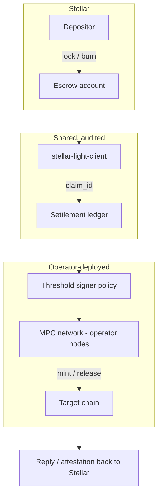

# 05 - Configurable third-party bridge of trust

**Status: composes.** The light client is explicitly designed to sit *under* a
bridge. The build is the configurable operator-facing layer.

## Problem

Cross-chain asset movement today means either relying on an intents network you do
not control, or running bridge infrastructure yourself and sitting on a critical
path you cannot afford to be on.

The stated constraint from the 2026-10-09 discussion is operational, not technical:
building a bridge is straightforward; *operating* one means becoming public-good
infrastructure for the Stellar-NEAR link, and that critical path is unacceptable for
the team. The resolution was to build the machinery and the configurability, and let
third parties deploy and run their own.

## What the light client gives you

The contract's own storage discipline says exactly where the line is
(`contract/src/lib.rs:22-28`):

> Payloads (headers, transaction sets, envelopes) are calldata only — verified in
> memory, never written to state. State holds just the chain head and the trust
> configuration. **Recording a proven transaction as settled is the consuming
> application's business (a bridge built on this light client), not the light
> client's.**

So the light client contributes the *verification* half of a bridge and deliberately
stops there. That is the correct decomposition for a shippable product: the
trust-minimized part is shared and auditable; the operational part is per-operator.

Concretely available:

- Span authentication and chain-head advancement (`submit_span`,
  `submit_span_raw`).
- Inclusion claims with `claim_id = sha256(tx envelope)` — a natural idempotency and
  replay key for the bridge ledger (use case 01).
- A trust set that is **operator configuration**: node ids plus a threshold, chosen
  per deployment (`verify-core/src/lib.rs:51-73`), with a domain-separated
  `trust_digest`. Different operators get different trust sets without different code.
- Epoch compression so a bridge can verify long ranges cheaply
  (`guest/`, `verify-core/src/journal.rs`).

## Proposed shape

The trust set, the threshold, the signer set, and the mint policy are all
per-operator configuration. The verification is not. A deployment replaces
proof-of-authority with proof: instead of trusting that the operator's nodes observed
the deposit, anyone can check the claim against the authenticated chain.

This is the fork-and-harden play discussed for an Omni-style bridge: take the
operational shape that already works, swap the authority assumption for the light
client's proof, and ship it as deployable infrastructure.

## What has to be built

| work item | notes |
|---|---|
| Settlement contract | consumes `claim_id`s, dedupes, releases on target chain |
| Operator configuration surface | trust set, threshold, signer set, mint limits, pause |
| Threshold signing integration | the MPC/threshold wallet the operator runs |
| Replay and reorg policy | idempotency on `claim_id`; confirmation-depth policy |
| Reply / attestation leg | use case 07 or 08, so the Stellar side learns the outcome |
| Deployment tooling | the whole point is that a third party can stand this up |

Optional, discussed as an alternative to owning the link: **extra proving on top of
existing messaging infrastructure** (LayerZero, Chainlink, CCTP). The light client
adds verifiable assertions over what those transports carry, without replacing them.

## Trust model

Per operator, and visible in configuration rather than hidden in code:

- Which validator nodes are trusted, and at what threshold. This is the trust set
  (`verify-core/src/lib.rs:51-73`).
- Which RISC Zero wrapper build is accepted (`control_root`, `bn254_control_id`).
- Which guest image is accepted (`epoch_image_id`, owner-rotatable).
- Which signers may mint, and up to what limits — the operator's policy, not the
  light client's.

The valuable property is that a *third party* can audit all four from the deployed
contract state (`get_trust`, `get_epoch_image`, `get_wrapper`, `get_head`) instead of
trusting the operator's README.

## Limits

- **The light client does not settle.** Any bridge built on it must implement
  settlement itself. That is intentional and documented.
- **Inclusion is not success** (use case 01). A bridge that releases funds on a
  proven inclusion of a transaction that then failed is a bug, not a light-client
  limitation being worked around. Transaction results *are* header-committed via
  `tx_set_result_hash` (use case 01, "Proving outcomes"), so require that extension
  rather than settling for inclusion-only, and design the escrow around the outcome.
- **Operational risk does not disappear.** Moving from PoA to proof changes who you
  must trust about *observation*. It does not change key management, upgrade
  authority, or liveness of the operator's signer set.
- Running this as public-good infrastructure was explicitly rejected. Do not let the
  deployment tooling quietly make the team the default operator.

## Acceptance criteria

- [ ] A third party can deploy the stack with their own trust set, threshold, and
      signer set using only the published tooling.
- [ ] A claim proven under operator A's trust set is refused under operator B's.
- [ ] The settlement contract is idempotent on `claim_id` and refuses double release.
- [ ] All four trust surfaces are readable from deployed state without operator
      cooperation.
- [ ] The team is not on the critical path for any deployment's liveness.
