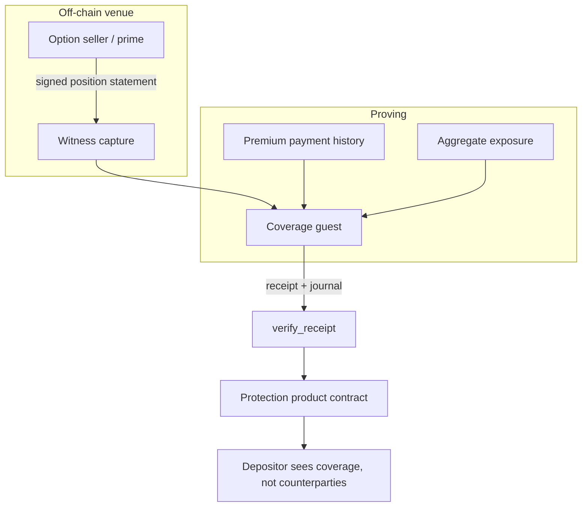

# 06 - Hedge and option coverage attestation

**Status: new proving work.** Shares use case 04's witness leg; the coverage-mapping
and privacy design are the new part.

## Problem

A vault sells a liquidation-protection product: the borrower pays a recurring
subscription, and that income funds out-of-the-money put options so the position is
effectively liquidation-free. The strategy is sound. The *attestation* is not.

The depositor's question is blunt: **how do I know they actually bought the option?**
The proposed answers in the 2026-10-09 discussion were, in order of quality:

1. Transfer the premium to the option seller so they can take delivery — verifiable,
   but couples the product to whoever sells the option.
2. A legal agreement — unenforceable for a depositor without standing.
3. A "trust me bro" attestation — which is what the product should not ship with.

## Why this is harder than it looks

Coverage is **bundled, not one-to-one.** Depositors of $1k, $2k and $100k share a
covering position; they are not each mapped to their own option. So any attestation
has to answer two questions at once:

- Is there a covering position large enough for the aggregate exposure?
- Which depositors share which covering position?

And answering the second publicly is itself a leak: it reveals who else is in the
product with you and at what size. The discussion flagged exactly this.

## What the light client gives you

- A reusable receipt verifier (`verify_receipt`,
  `contract/src/lib.rs:508-566`) so a coverage guest needs no new on-chain
  verifier, only a pinned `image_id`.
- A compact commitment format. The `EpochJournal` shape
  (`verify-core/src/journal.rs:3-24`) is the model for a coverage journal: commit
  aggregate figures and opaque position handles, not per-depositor rows.
- The `claim_id` structure from use case 01 if the premium payment itself travels on
  Stellar and needs to be shown as settled.

## Proposed shape

The coverage guest commits, in one journal:

- aggregate covered notional and aggregate exposure, and the ratio;
- the maturity profile (the strategy mixes longer-dated base coverage with monthly
  options activated only when the price is within a trigger distance of liquidation —
  the journal should commit the ladder, not a single number);
- opaque position handles so an auditor with the venue statement can reconcile
  without the handle list becoming public;
- `as_of`, so a stale ladder cannot be replayed as current.

Per-depositor allocation stays in the product contract as an internal mapping. The
proof answers "is the book covered", not "which option covers you".

## What has to be built

| work item | notes |
|---|---|
| Venue statement format | what the option seller signs; must include notional, strike, maturity |
| Coverage guest | verifies venue signature, checks aggregate exposure, commits the ladder |
| Aggregate exposure feed | what the product contract exposes as the thing being covered |
| Allocation mapping | depositor -> covering pool, private, in the product contract |
| Freshness and rollover policy | monthly options roll; the proof must not outlive the ladder |
| Settlement of the option itself | a proof that an option exists is not a proof it pays out |

The last row is the one that matters most. Proving a position exists is not proving
it settles. Either the product uses delivery-style settlement the proof can follow,
or it accepts that payout is a venue credit risk and says so.

## Trust model

- The option seller's signature is the anchor. You are proving "Seller S holds a
  position with these terms", not "you will be paid".
- The premium-payment leg is the alternative anchor: if the journal also commits the
  premium flows and those are proven Stellar inclusions (use case 01), the depositor
  can see that the subscription income was actually spent on coverage.
- The consumer pins the coverage-guest `image_id` and enforces `as_of` staleness.

## Limits

- **Existence is not payout.** A signed position statement proves the position was
  opened. It does not prove the seller is solvent at exercise.
- **Bundling is inherent.** No proof gives a depositor a dedicated option without
  changing the product economics.
- **Allocation privacy and auditability trade off.** Opaque handles let an auditor
  reconcile while keeping counterparties private; they do not let an individual
  depositor verify their own slice without trusting the product contract.
- None of this is in the repository today. `verify_span` proves headers, quorum and
  inclusion (`verify-core/src/lib.rs:234-369`); nothing here relates to derivatives
  positions.

## Acceptance criteria

- [ ] Coverage guest rejects a statement whose venue signature does not verify.
- [ ] The journal commits aggregate coverage, exposure, ratio, maturity ladder, and
      `as_of` — and does not commit per-depositor identity.
- [ ] The product contract refuses to advertise coverage when the ratio falls below
      its floor.
- [ ] A depositor can independently confirm the aggregate figure from the receipt
      without access to the allocation mapping.
- [ ] Documentation states plainly that the attestation proves position existence,
      not payout.
