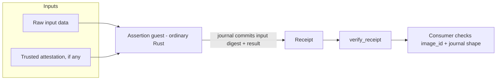

# 07 - Verifiable state reads and off-chain attestation

**Status: composes.** This is the mechanism that makes use cases 03, 04 and 06 cheap.
The verifier already exists; each assertion needs its own guest program.

## Problem

Much of what a financial product needs to know is neither on Stellar nor on NEAR. It
is an off-chain fact, an internal computation, or a policy decision that a party
performed: an orchestrator routed an order, a keeper rebalanced, a model scored a
portfolio, a batch was aggregated correctly.

Today those are "trust me bro" assertions. The goal is a general way to replace them
with a receipt anyone can check, without building a new verifier every time.

## What the light client gives you

**A generic, already-deployed receipt verifier.** `verify_receipt`
(`contract/src/lib.rs:508-566`) verifies a RISC Zero Groth16 receipt for a
caller-named image and journal. The claim digest is derived on-chain, so only the
canonical success claim (`Halted(0)`) of that image over that journal can verify.

**A shared trust anchor.** The Groth16 key is RISC Zero's wrapper key — one key for
every program built with the same tooling version. The wrapper is pinned once as
`control_root` + `bn254_control_id` (`contract/src/lib.rs:468-506`). Adding an
assertion means adding a guest program and pinning its `image_id`; it does not mean
new on-chain cryptography.

**A working template.** The epoch guest is the reference implementation of the
pattern (`guest/methods/guest/src/lib.rs`):

- input is fixed-int bincode `EpochInput { trust, start_seq, start_hash, spans }`;
- it runs `verify_core::verify_span` per span — the *same* code the NEAR contract
  runs, so the journal was produced by the identical verification path;
- it commits the canonical journal bytes verbatim so the receipt journal digests to
  exactly `sha256(encode_journal bytes)`.

Writing a new assertion is "write raw Rust" and use the same verification
infrastructure. That is the multiplier behind every other use case here.

## The one correctness requirement that matters

A RISC Zero receipt proves: *image `image_id` ran to `Halted(0)` and committed
journal `J`.*

It does **not** prove that `J` is true, and it does **not** bind `J` to the input the
prover supplied. The input is written through `ExecutorEnv`; it is not automatically
committed. If a guest computes `J` from input `I` without committing anything derived
from `I`, the verifier cannot tell which input produced `J`, and a prover can supply
whatever `I` yields the `J` they wanted.

**Every state-read guest MUST commit a binding digest of its inputs into its journal.**

The epoch guest already gets this right: its journal commits `start_seq`,
`start_hash`, `end_seq`, `end_hash`, `policy_digest` and `claim_ids`
(`verify-core/src/journal.rs:3-24`), and those transitively bind the span contents
through the header chain and the `sha256(tx envelope)` claim ids. A new guest that
omits this is worse than no proof, because it looks like one.

## Proposed shape

## Assertion classes this supports

| class | example | input binding |
|---|---|---|
| Deterministic derivation | "the aggregate of these 10k rows is X" | hash the rows into the journal |
| Computation provenance | "the orchestrator executed policy P over state S" | hash S and the policy id |
| Attested external fact | "venue V asserted balance B" | verify V's signature inside the guest |
| Large-history compression | "these N ledgers contain these claims" | already shipped as the epoch guest |

The third class is the only one that imports external trust, and the guest makes that
trust explicit by verifying the attester's signature rather than taking the value on
the prover's word.

## What has to be built

Per assertion: the guest program, its input and journal schema, the `image_id` pin
in the consumer, and the input-binding rule. Nothing else.

Also worth building once, since every use case needs it: a journal schema convention
(version tag, input digest, result fields) so consumers can reject a journal from a
different assertion shape instead of misparsing it. `decode_journal` shows the
pattern — it rejects v0 journals, short input, claim-count mismatch and trailing
garbage (`verify-core/src/journal.rs:22-24`).

## Trust model

- `verified: true` means: the pinned image committed this journal. That is all.
- The consumer MUST check `image_id`. The contract's own documentation says so
  (`contract/src/lib.rs:513-514`) and deliberately does not enforce it for this
  entry point, because the image is the caller's choice by design.
- The wrapper identity is shared trust. Re-pin the VK and claim digest if any
  *verification* crate bumps (`AGENTS.md`).

## Limits

- **A proof of computation is not a proof of the world.** Attesting "the orchestrator
  did a thing" attests to what the program saw. If the program saw attacker-chosen
  input and did not verify it, the proof is faithfully proving a lie.
- `verify_receipt` is not epoch-bound and proves nothing about Stellar. Use
  `verify_claim` for chain facts.
- The Groth16 seal is 256 bytes (`contract/src/lib.rs:545`), so the on-chain cost of
  an assertion is dominated by the journal and the consumer logic, not the proof.

## Acceptance criteria

- [ ] Each guest commits a binding digest of every input into its journal.
- [ ] A journal produced from a different input is not accepted for the same claim.
- [ ] The consumer rejects a journal whose schema tag does not match the assertion.
- [ ] The consumer rejects any `image_id` other than the pinned one for that
      assertion.
- [ ] The reference epoch guest's input binding is documented as the pattern to copy.
